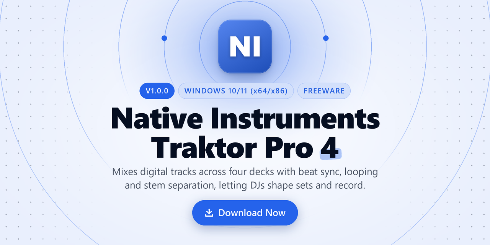

<h1 align="center">Native Instruments Traktor Pro 4 - Four-Deck DJ Mixing Suite for Windows 10/11</h1>

<p align="center"><i>Traktor Pro 4 is Native Instruments' flagship DJ performance application, built for club DJs, radio hosts, and live remixers who need four-deck beat sync, looping, and stem-level control. This page documents requirements, configuration paths, comparison modes, shortcuts, CLI flags, and Windows-specific fixes for administrators and power users.</i></p>

<p align="center">&nbsp;&nbsp;&nbsp;&nbsp;&nbsp;&nbsp;&nbsp;&nbsp;</p>

<p align="center"></p>

<p align="center">
  <a href="https://putrasantoso4.github.io/native-instruments-traktor-pro-4/">
    <picture>
      <source media="(prefers-color-scheme: dark)" srcset="./assets/Click-dark.svg">
      
    </picture>
  </a>
</p>

## Table of Contents

<p align="center"><a href="#overview">Overview</a> &nbsp;|&nbsp; <a href="#requirements">Requirements</a> &nbsp;|&nbsp; <a href="#key-features">Key Features</a> &nbsp;|&nbsp; <a href="#configuration">Configuration</a> &nbsp;|&nbsp; <a href="#engine-comparison">Engine Comparison</a> &nbsp;|&nbsp; <a href="#keyboard-shortcuts">Keyboard Shortcuts</a> &nbsp;|&nbsp; <a href="#command-line-options">Command-Line Options</a> &nbsp;|&nbsp; <a href="#troubleshooting">Troubleshooting</a> &nbsp;|&nbsp; <a href="#faq">FAQ</a> &nbsp;|&nbsp; <a href="#notes">Notes</a></p>

## Overview

Traktor Pro 4 runs as a Windows desktop audio engine that aggregates controllers, audio interfaces, and streaming inputs into a single low-latency mixer. The sections below document deployment and operation expectations.

### What It Does

Traktor Pro 4 loads four independent decks, each with beat grid analysis, sync, hotcue, loop, and stem channel control, then routes the mix through an assignable audio interface. It records master output, captures loops to the Remix deck, and streams metadata to external tools over a local API.

### Who It Is For

Club DJs running HID controllers, radio presenters who need a reliable two-deck fallback, and live remixers using stem separation to isolate vocals or drums mid-set. Power users typically customize the mapping layer rather than the factory layout.

### What Ships in the Build

The installer deploys the main application, the Traktor Service host, the Native Access activation client, the controller mapping editor, and the bundled audio analyzer. Stems and Remix decks require the Pro tier activation.

## Requirements

| Spec | Minimum | Recommended |
|------|---------|-------------|
| OS | Windows 10 21H2 (64-bit) | Windows 11 23H2 (64-bit) |
| CPU | Intel Core i5 6th gen / AMD Ryzen 5 1600 | Intel Core i7 10th gen / AMD Ryzen 7 5800X |
| RAM | 8 GB | 16 GB |
| GPU or display | 1280x800, DirectX 11 capable | 1920x1080, dedicated GPU |
| Storage | 15 GB free for install plus library cache | SSD with 50 GB free, separate library drive |
| Audio interface | ASIO-compatible, 44.1 kHz | 48 kHz/24-bit ASIO with dedicated driver |
| Controller support | Keyboard and mouse | HID/MIDI controller with native mapping |

## Key Features

* **Four-Deck Mixing** , run up to four tracks simultaneously with independent transport, EQ, and filter chains.
* **Beat Sync and Grid** , align tracks to a master clock using analyzed beat grids or manually adjusted downbeats.
* **Loop and Hotcue Bank** , store up to eight hotcues and multiple loops per deck for instant recall.
* **Stem Separation** , split tracks into vocals, drums, bass, and melody channels and process each independently.
* **Remix Decks** , trigger one-shot samples and loops from a 64-slot grid synced to the master tempo.
* **Controller Mapping Editor** , remap any MIDI or HID control to mixer functions without external scripts.
* **Mix Recording** , capture the master bus to WAV or AIFF at the configured sample rate and bit depth.
* **External Mixer Routing** , assign decks to discrete output channels for use with analog club mixers.

## Configuration

| Path | Purpose |
|------|---------|
| `%APPDATA%\Native Instruments\Traktor` | User settings, layout, and controller mappings |
| `%LOCALAPPDATA%\Native Instruments\Traktor` | Analysis cache, waveform previews, and transient data |
| `%PROGRAMDATA%\Native Instruments\Traktor` | Shared device profiles and factory mapping database |
| `%USERPROFILE%\Music\Traktor` | Default recording output and exported playlists |
| `%APPDATA%\Native Instruments\Native Access` | Activation tokens and license cache |
| `%PROGRAMDATA%\Native Instruments\Service` | Traktor Service host logs and IPC state |

| Setting | Default | Notes |
|---------|---------|-------|
| Audio device driver | WASAPI shared | Switch to ASIO for low-latency club use |
| Sample rate | 44100 Hz | Match to audio interface; 48000 Hz recommended for stems |
| Buffer size | 512 samples | Lower to 128 to 256 for ASIO, raise if dropouts occur |
| Sync mode | Beat sync | Tempo sync, beat sync, or none per deck |
| Analysis on import | Enabled | Disable to reduce CPU during large batch imports |
| Update channel | Stable | Switch to Beta only for controller beta testing |
| Log level | Info | Raise to Debug for support tickets under `%LOCALAPPDATA%` logs |

## Engine Comparison

| Engine | Deck Count | Stem Support | Latency (ASIO, 128 samples) | Best For |
|--------|-----------|--------------|------------------------------|----------|
| Internal Mixer | 4 | Yes | 3 to 5 ms | Single laptop, full in-the-box mixing |
| External Mixer | 4 | Yes | 3 to 5 ms | Club installs with analog console |
| Remix Deck Engine | 4 plus 4 slots | Partial | 5 to 8 ms | Live loops and sample triggering |
| Stems Mode | 4 | Full | 6 to 10 ms | Vocal isolation and live edits |
| Streaming Input | 2 | No | 8 to 15 ms | Radio and hybrid digital sets |

## Keyboard Shortcuts

| Action | Shortcut |
|--------|----------|
| Play/Pause Deck A | `Q` |
| Play/Pause Deck B | `W` |
| Sync Deck A to master | `A` |
| Sync Deck B to master | `S` |
| Cue Deck A | `Z` |
| Cue Deck B | `X` |
| Set loop in point | `I` |
| Set loop out point | `O` |
| Activate loop | `L` |
| Save loop to Remix slot | `Shift` + `L` |
| Open controller mapping editor | `Ctrl` + `M` |
| Toggle full-screen browser | `Space` |

## Command-Line Options

| Flag | Argument | Purpose |
|------|----------|---------|
| `--collection` | `path` | Load an alternate `collection.nml` file on startup |
| `--settings` | `path` | Override the `%APPDATA%` settings directory |
| `--device` | `name` | Force a specific ASIO or WASAPI audio device |
| `--driver` | `asio` or `wasapi` | Force the audio driver backend |
| `--standalone-analyze` | `path` | Run batch analysis on a folder and exit |
| `--no-service` | none | Skip starting the Traktor Service host |
| `--log-level` | `debug`, `info`, `warn` | Set runtime log verbosity |
| `--reset-layout` | none | Restore default deck layout for the active user |

```
Traktor.exe --driver asio --device "Focusrite USB ASIO" --log-level debug
```

| Exit Code | Meaning |
|-----------|---------|
| `0` | Clean shutdown |
| `1` | Audio device initialization failure |
| `2` | Settings or collection file unreadable |
| `3` | License or activation validation failed |
| `4` | Analysis batch completed with errors |

## Troubleshooting

### Crackling or dropouts during playback

Audio stutters or clicks when two or more decks are active with stem processing.

1. Switch the audio driver from WASAPI shared to ASIO in the audio preferences.
2. Raise the buffer size to 256 or 512 samples and retest.
3. Exclude the `%LOCALAPPDATA%\Native Instruments\Traktor` cache folder from real-time antivirus scanning.
4. Set Windows power plan to High Performance and disable USB selective suspend.
5. Confirm the audio interface is on a dedicated USB controller, not a shared hub.

### Controller not detected after Windows update

The HID or MIDI controller no longer appears under the Controller Manager list.

1. Open Device Manager and verify the controller enumerates under Sound, video, and game controllers.
2. Reinstall the vendor driver from the controller manufacturer, not Windows Update.
3. In Traktor, open `Preferences > Controller Manager` and re-import the `.tsi` mapping file.
4. Restart the Traktor Service host from `services.msc` if the device list stays empty.
5. Test on a USB 2.0 port if the controller does not bind on USB 3.0.

### Stem separation returns silent channels

Stems load but vocals, drums, bass, or melody channels output silence.

1. Confirm the Pro tier is activated under `Native Access` and not an older license.
2. Verify the track's stem file exists under the library folder and is not a streaming placeholder.
3. Re-run analysis on the track from the collection context menu and allow stem regeneration.
4. Raise the buffer size to at least 256 samples; stems fail silently at overly low latencies on some ASIO drivers.

### Library scan stalls at a specific file

Collection import freezes on a single track and never progresses.

1. Close Traktor and move the suspect file out of the watched folder.
2. Delete `%LOCALAPPDATA%\Native Instruments\Traktor\analysis` cache entries for that track.
3. Restart and re-import the folder with the file excluded to confirm the culprit.
4. Re-encode the file to 44.1 kHz WAV and re-add it to the library.

## FAQ

### Can I run Traktor Pro 4 with two laptops and share the master clock?

Yes. Use the Link or external MIDI clock sync over a wired network, keep both machines on the same subnet, and disable Wi-Fi power saving on both adapters. The master clock should be assigned to the laptop driving the primary audio interface.

### Does stem separation work on tracks from streaming services?

Stem separation requires a locally analyzed audio file. Streaming titles cached by the service are DRM-protected and cannot be split, so stems only apply to files you own and import into the local collection.

### How do I migrate my collection and mappings to a new Windows machine?

Copy `%APPDATA%\Native Instruments\Traktor` and the library root, then re-run Native Access activation on the new machine. Traktor will re-analyze tracks on first load unless the `analysis` cache folder is copied alongside the settings.

## Notes

Traktor Pro 4 and Native Instruments are trademarks of Native Instruments GmbH. Windows is a trademark of Microsoft Corporation. Feature availability, controller support, and stem behavior depend on the licensed edition and installed audio drivers.